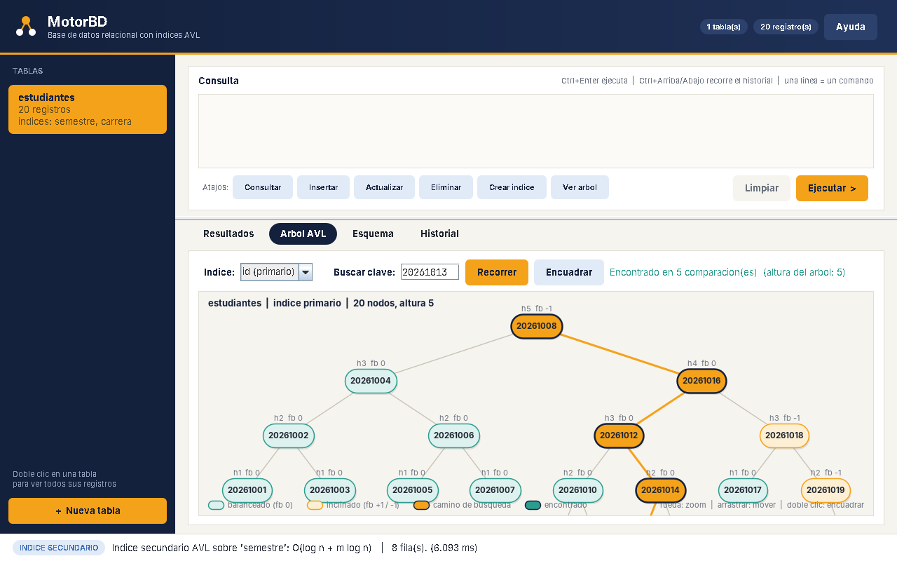
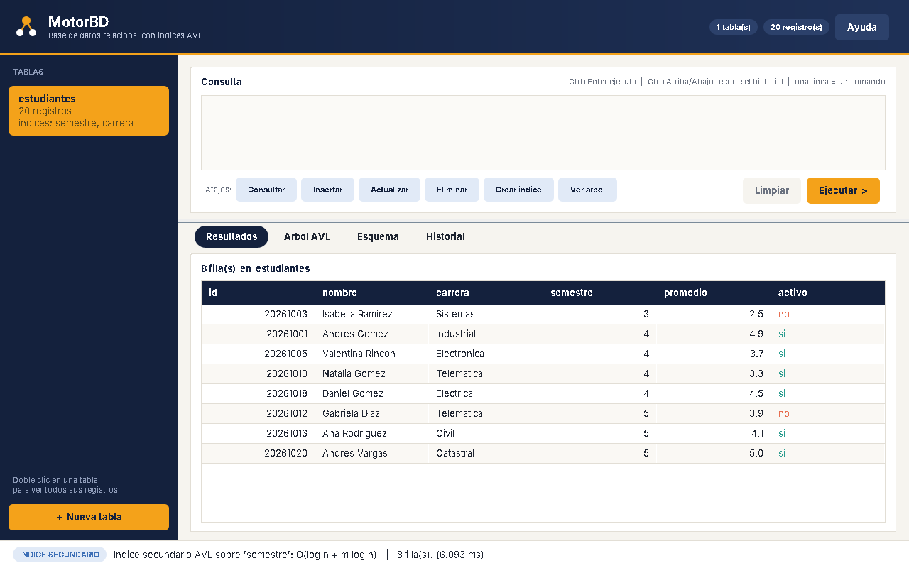

# MotorBD: motor de base de datos relacional con árbol AVL

Proyecto final de Ciencias de la Computación I. Es un gestor de bases de datos relacional sencillo, escrito en Java sin librerías externas, que:

- crea y borra tablas con esquema tipado (`INT`, `TEXT`, `REAL`, `BOOL`) y clave primaria;
- inserta, busca, actualiza y elimina registros con comandos tipo SQL;
- indexa la clave primaria y los campos que el usuario elija con un **árbol AVL propio**;
- guarda los datos en archivos JSON con **escritura atómica** y los recupera al reiniciar;
- se usa desde una **consola (REPL)** y, como extra, desde una **interfaz gráfica** que dibuja el árbol.

El código sigue el patrón **MVC**: el modelo (`modelo`) guarda y busca los datos, el controlador (`controlador`) interpreta los comandos y las vistas (`vista`) muestran los resultados.





## Requisitos

| Herramienta | Versión |
|---|---|
| Java JDK | 17 o superior |
| Maven | 3.8 o superior (NetBeans, IntelliJ y VS Code lo traen integrado) |

## Cómo ejecutarlo

Desde la carpeta del proyecto:

```bash
mvn package                         # compila, corre las pruebas y crea target/motorbd.jar
java -jar target/motorbd.jar        # consola (REPL)
java -jar target/motorbd.jar --gui  # interfaz gráfica
java -jar target/motorbd.jar --gui-clasica  # interfaz gráfica anterior (versión 1)
```

### La interfaz gráfica

- **Barra lateral:** las tablas con su número de registros e índices. Doble clic muestra todos los registros; "+ Nueva tabla" deja lista una plantilla de `CREATE TABLE`.
- **Editor de consultas:** `Ctrl+Enter` ejecuta (una línea = un comando, o solo el texto seleccionado); `Ctrl+Arriba/Abajo` recorre el historial. Los atajos (Consultar, Insertar, Actualizar, Eliminar, Crear índice, Ver árbol) escriben un ejemplo con la tabla seleccionada.
- **Resultados:** la tabla de filas, y abajo una insignia de color con el plan usado (índice primario, índice secundario o recorrido completo) y el tiempo.
- **Árbol AVL:** dibujo del índice elegido, coloreado por factor de balance. "Buscar clave" resalta el camino que recorre la búsqueda y dice cuántas comparaciones hizo. Rueda del mouse: zoom; arrastrar: mover.
- **Esquema** e **Historial** de comandos con sus respuestas.

La versión anterior de la interfaz sigue disponible con `--gui-clasica` y en la rama `gui-clasica` del repositorio.

Otras opciones:

```bash
java -jar target/motorbd.jar --script datasets/pequeno.sql   # ejecuta un script y sale
java -jar target/motorbd.jar --datos otra_carpeta            # usa otra carpeta de datos (por defecto ./data)
```

También están los atajos `scripts/ejecutar.sh` y `scripts/ejecutar.bat` (Windows).

**Desde un IDE:** abra la carpeta como proyecto Maven y ejecute la clase `com.motorbd.Main`. Para la GUI agregue el argumento `--gui`.

## Datasets de prueba

| Archivo | Contenido |
|---|---|
| `datasets/pequeno.sql` | Crea la tabla `estudiantes` con 20 registros e índices sobre `semestre` y `carrera` |
| `datasets/mediano.csv` | 10.000 registros en orden aleatorio |
| `datasets/cargar_mediano.sql` | Crea `estudiantes_m`, sus índices sobre `promedio` y `carrera`, y carga el CSV |

Para cargarlos:

```bash
./scripts/cargar_datasets.sh        # Linux / macOS
scripts\cargar_datasets.bat         # Windows
```

O dentro de la consola: `SOURCE "datasets/pequeno.sql"` y `SOURCE "datasets/cargar_mediano.sql"`.

Para regenerarlos (por ejemplo con 100.000 filas): `./scripts/generar_datasets.sh 100000`.

## Comandos

Las palabras clave no distinguen mayúsculas. El `;` final es opcional. Los textos van entre comillas dobles o simples.

| Comando | Ejemplo |
|---|---|
| Crear tabla | `CREATE TABLE alumnos (id INT PRIMARY KEY, nombre TEXT, nota REAL, activo BOOL)` |
| Borrar tabla | `DROP TABLE alumnos` o `DROP TABLE IF EXISTS alumnos` |
| Ver tablas | `SHOW TABLES` |
| Ver esquema | `DESCRIBE alumnos` |
| Crear / borrar índice | `CREATE INDEX ON alumnos (nota)` / `DROP INDEX ON alumnos (nota)` |
| Insertar | `INSERT INTO alumnos VALUES (1, "Ana", 4.5, true), (2, "Luis", 3.2, false)` |
| Insertar con columnas | `INSERT INTO alumnos (id, nombre, nota, activo) VALUES (3, "Eva", 4.0, true)` |
| Buscar todo | `SELECT * FROM alumnos` |
| Buscar por clave | `SELECT * FROM alumnos WHERE id = 1` |
| Buscar por rango | `SELECT nombre, nota FROM alumnos WHERE nota BETWEEN 3.5 AND 5` |
| Buscar por igualdad | `SELECT * FROM alumnos WHERE nombre = "Ana"` |
| Actualizar | `UPDATE alumnos SET activo = false WHERE nota < 3.0` |
| Eliminar | `DELETE FROM alumnos WHERE id = 2` o `DELETE FROM alumnos WHERE activo = false` |
| Carga masiva | `LOAD alumnos "archivo.csv"` (CSV con encabezado) |
| Ejecutar script | `SOURCE "script.sql"` (un comando por línea, `--` para comentarios) |
| Ver árbol | `TREE alumnos` o `TREE alumnos nota` |
| Ayuda / salir | `HELP` / `EXIT` |

Operadores del `WHERE`: `=`, `!=` (o `<>`), `<`, `<=`, `>`, `>=`, `BETWEEN x AND y`. Se admite una condición por consulta.

Cada `SELECT` muestra el **plan** usado: índice primario, índice secundario o recorrido secuencial.

### Ejemplo de sesión

```
motorbd> CREATE TABLE alumnos (id INT PRIMARY KEY, nombre TEXT, edad INT, nota REAL, activo BOOL)
OK: tabla 'alumnos' creada.
motorbd> INSERT INTO alumnos VALUES (1, "Ana", 20, 4.5, true), (2, "Luis", 22, 3.1, true)
OK: 2 fila(s) insertada(s).
motorbd> CREATE INDEX ON alumnos (edad)
OK: indice AVL creado sobre alumnos(edad).
motorbd> SELECT nombre FROM alumnos WHERE edad >= 21
+--------+
| nombre |
+--------+
| Luis   |
+--------+
Plan: Indice secundario AVL sobre 'edad': O(log n + m log n)
1 fila(s). (0.210 ms)
motorbd> INSERT INTO alumnos VALUES (3, "Eva", "diez", 2.0, true)
ERROR: Valor "diez" no es valido para el campo 'edad' de tipo INT.
```

## Pruebas

```bash
mvn test
```

45 pruebas con JUnit 5 en 4 clases:

| Clase | Qué comprueba |
|---|---|
| `AVLArbolTest` | Las 4 rotaciones, eliminación (hoja, un hijo, dos hijos), recorrido inorden, rangos, altura logarítmica con 100.000 inserciones ordenadas y 20.000 operaciones aleatorias comparadas contra `TreeMap` |
| `BaseDatosTest` | Inserción, búsqueda por clave, por rango y por campo indexado, actualización y eliminación por condición, validación de tipos, clave repetida |
| `PersistenciaTest` | Recuperación tras reinicio (datos e índices), archivo dañado que no se sobrescribe, fallo de disco simulado que deshace la operación, temporales huérfanos |
| `ControladorTest` | Lexer, parser y errores de sintaxis, comandos completos, scripts y carga de los datasets reales |

## Estructura

```
src/main/java/com/motorbd/
├── Main.java                         arma el MVC y elige la vista
├── modelo/                           MODELO
│   ├── BaseDatos.java                fachada: CRUD atómico y catálogo de tablas
│   ├── ErrorMotor.java               errores para el usuario
│   ├── Csv.java                      lectura de CSV para LOAD
│   ├── indice/AVLArbol.java          árbol AVL propio (+ AVLNodo.java)
│   ├── esquema/                      Tipo, Campo, Esquema, Identificadores
│   ├── datos/                        Tabla, Fila, Condicion, Operador, ResultadoBusqueda
│   └── persistencia/                 Persistencia (escritura atómica), Json (lector/escritor propio)
├── controlador/                      CONTROLADOR
│   ├── Lexer.java, Token.java        texto -> tokens
│   ├── Parser.java                   tokens -> Comando
│   ├── comandos/                     un record por comando
│   ├── Controlador.java              ejecuta el comando sobre el modelo
│   └── Resultado.java                respuesta para la vista
├── vista/                            VISTA
│   ├── VistaConsola.java             REPL
│   ├── FormatoTabla.java             tablas de texto
│   ├── VistaGrafica.java             GUI Swing (extra)
│   ├── PanelArbol.java               dibujo interactivo del árbol AVL
│   ├── Tema.java                     colores, fuentes y componentes con estilo propio
│   └── clasica/                      interfaz gráfica anterior (--gui-clasica)
└── herramientas/GeneradorDatasets.java
```

La documentación técnica está en [`docs/documentacion_tecnica.pdf`](docs/documentacion_tecnica.pdf).

## Formato en disco

```
data/
├── catalogo.json      esquemas de las tablas y campos indexados
└── estudiantes.json   filas de la tabla, ordenadas por clave primaria
```
